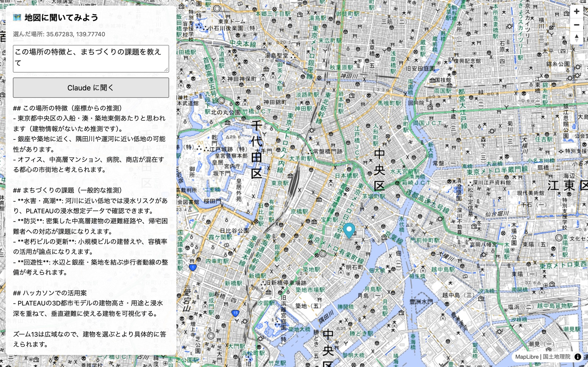

ここからは Claude に頼みます。

```
README を読んで、backend と web-maplibre を起動して
```

Claude が `npm install` などを実行し、最後に `http://localhost:5173` を教えてくれます。ブラウザで開いてください。

- 🛡️ 安全コースの人も、そのまま手元のブラウザで開けます（`sbxenv.yaml` でポートを公開済み）

地図をクリック →「Claude に聞く」で答えが返ってきたら成功です。



:::tip[☕ Coffee Break：localhost って何？]
「自分の PC の中だけで開いているお店」です。あなたのブラウザからは見えますが、隣の人の PC からは見えません。
みんなに見せるには 7 章で「公開」します。
:::

:::tip[☕ Coffee Break：クライアントとサーバー]
このアプリは 2 つに分かれています。
- **web-maplibre** … ブラウザで動く **クライアント**。地図とボタンを表示するだけ
- **backend** … **サーバー**。AWS の合鍵を持っていて、Claude に質問する

合鍵をクライアントに置くと、ブラウザから誰でも中身を見られてしまうので、サーバーだけに置いています。
💡 「これはサーバー？クライアント？」と Claude に聞けば教えてくれます。
:::

## 🧪 上級オプション: Claude に画面を確認させる（🛡️ 安全コース）

`sbxenv.yaml` の `kits:` の 2 行のコメント（`# `）を外して、砂場を作り直す（`sbx env rm` → `sbx env run`）と、Playwright が入ります。
```
web-maplibre を Playwright で開いて、地図が表示されているか確認して
```

## 3D 版を動かす

```
web-navara も起動して
```
→ `http://localhost:5174`（詳しくは [付録B](appendix-b-navara.md)）

:::tip[☕ Coffee Break：データはどこにあるの？]
- 地図の画像 … 国土地理院のサーバー（毎回ダウンロード）
- PLATEAU の建物 … PLATEAU 配信サービスのサーバー
- あなたの書いたコード … あなたの PC（または砂場）の中
- Claude の答え … AWS で作られ、ブラウザに届いた時点で表示されるだけ（どこにも保存されない）
:::
