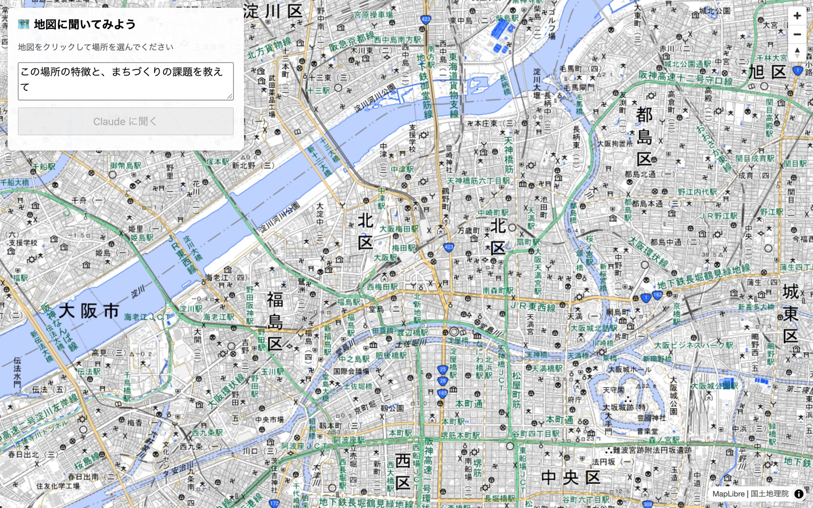
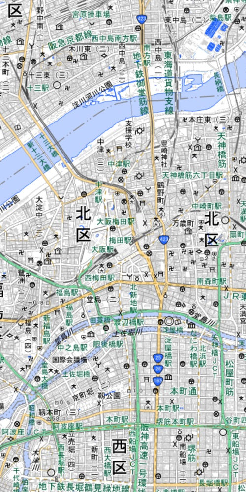
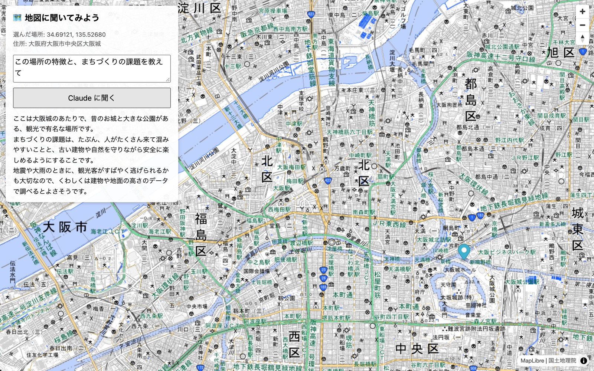

5章で動いたアプリを、**日本語で頼むだけで** 自分好みに変えていきます。
コードを自分で書く必要はありません。あなたの役目は「どうしたいか」を伝えて、ブラウザで結果を確かめることです。

:::note[準備]
5章のアプリ（`http://localhost:5173`）を起動したまま進めます。
Claude がファイルを書き換えると、ブラウザの画面も **自動で更新** されます。
:::

## 6-1. まずはアプリのことを聞いてみる

```
このアプリのファイル構成を、初心者向けに説明して。地図の画面と、AI に質問する部分はそれぞれどこ？
```

Claude がフォルダーの中を読んで説明してくれます。わからない言葉があれば、そのまま聞き返しましょう。

## 6-2. 地図の最初の場所を変える（クライアントの改造）

```
地図を開いたときの最初の場所を、（例: 大阪駅）にして
```

Claude が `web-maplibre/src/main.ts` を書き換えます。
ファイルを書き換える前に「やっていいですか？」と聞かれたら、内容を見て「Yes」を選びます。
ブラウザを見ると、地図の場所が変わっているはずです。



## 6-3. AI の答えをきれいに表示する（クライアントの改造）

5章で AI に聞いたとき、答えに `##` や `**` という記号がそのまま出ていませんでしたか？
これは AI が「見出し」や「太字」のつもりで書いた記号（Markdown）です。画面がそれを整形していないので、記号のまま見えています。

```
AI の答えに ## や ** がそのまま表示されている。見出しや太字として、きれいに表示して
```

Claude が、記号を見出しや太字に変換するしくみを作ってくれます。こちらも **10 分ほどかかる** ことがあります。



## 6-4. AI の答え方を変える（サーバーの改造）

```
AI の答えを、小学生にもわかる言葉で、3 行以内にして
```

今度は `backend/src/ask.ts`（サーバー）が書き換わります。地図をクリックして、もう一度「Claude に聞く」を押してみましょう。答え方が変わっていれば成功です。

:::tip[☕ Coffee Break：同じ「Claude」が 2 人いる？]
いま、Claude は 2 か所で働いています。
- **Claude Code** … あなたと会話して、コードを書き換えている Claude（ターミナルの中）
- **アプリの中の Claude** … 地図の「Claude に聞く」に答えている Claude（backend から Bedrock を呼んでいる）

6-4 では、Claude Code に頼んで、アプリの中の Claude への「指示書（システムプロンプト）」を書き換えてもらいました。
:::

## 6-5. ほかのサービスとつないで機能を足す

今度は、**国土地理院が公開している「住所を調べるサービス（API）」** とつないで、新しい機能を作ります。
地図をクリックした場所の住所が画面に出て、AI もその住所をもとに答えるようになります。

```
地図をクリックしたら、その場所の住所を国土地理院の API で調べて画面に表示して。AI に質問するときも、その住所を一緒に送って
```

少し大きな改造です。Claude がファイルを調べながら作業するので、**終わるまで 10 分ほどかかる** こともあります。のんびり待ちましょう ☕



うまくいかなかったら、見えている症状をそのまま伝えます。

```
住所が「undefined」と表示される
```
```
ブラウザに何も表示されなくなった。直して
```

:::tip[☕ Coffee Break：API って何？]
API は、ほかのサービスに「これを調べて」とお願いするための **窓口** です。
今回は、緯度・経度を送ると住所を返してくれる、国土地理院の窓口を使いました。
世の中には、天気・乗り換え・人口統計など、いろいろな API があります。組み合わせれば、自分でデータを持っていなくても、できることがどんどん増えます。
:::

## 6-6. 大きな改造は「まず計画」

いきなり書き換えてほしくないときは、**計画だけ** 先に出してもらいます。

```
（例: 地図に避難所を表示する）機能を作りたい。まだコードは書かずに、どう作るか計画だけ見せて
```

計画を読んで、よければ「その計画で進めて」と頼みます。
`Shift + Tab` で **plan mode**（計画モード）に切り替えても同じことができます。

## 6-7. 失敗したら元に戻す

「前のほうがよかった…」というときは、Claude の入力欄で **`Esc` を 2 回** 押す（または `/rewind`）と、会話の途中まで戻って、**ファイルもその時点に巻き戻せます**。

```
/rewind
```

戻したい地点を選んで、「コードも戻す」を選びます。
<!-- TODO(verify): /rewind の選択肢の表示名 -->

## 頼み方のコツ

| コツ | 例 |
|---|---|
| **1 回に 1 つ** だけ頼む | ×「色を変えて、ボタンを足して、AI も変えて」→ 1 つずつ |
| **見えていること** をそのまま伝える | 「ボタンを押しても何も起きない」「赤い文字で ○○ と出た」 |
| **エラーはコピーして貼る** | ターミナルやブラウザに出たエラーを、そのまま貼り付ける |
| **理由を聞く** | 「なぜそう直したの？」「他の方法は？」 |
| **わからなければ説明してもらう** | 「今の変更を、初心者向けに説明して」 |

ほかの頼み方は [プロンプト集](prompts.md) にまとめています。3D 版を改造したいときは [付録B](appendix-b-navara.md) も見てください。

:::tip[☕ Coffee Break：エージェンティックコーディングって何？]
「エージェント（代理人）」として AI が自分で考えて動くプログラミングのやり方です。
あなたが「何をしたいか」を伝えると、Claude が **ファイルを読む → 書き換える → 動かして確かめる → 直す** を自分で繰り返します。
あなたは「現場監督」。指示を出して、できあがりを確かめて、OK か直しかを伝えるのが仕事です。
:::

:::tip[☕ Coffee Break：なぜ画面が自動で変わるの？]
5章で起動した「開発用のお店」は、ファイルが書き換わったのを見張っていて、変わったらすぐに作り直してブラウザに届けます。
だから、Claude がコードを変えるたびに、画面がその場で変わります。
:::

改造ができたら、[7章](07-deploy.md) でインターネットに公開しましょう。**改造した内容がそのまま公開** されます。
