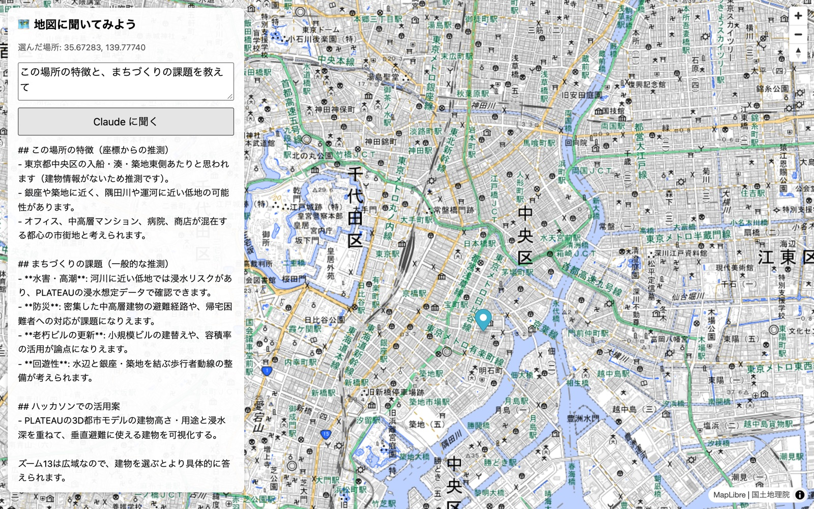

:::note[イベント情報]
**LINKS:POWER of DATA x DATA 2026 ハッカソン**（国土交通省）
- 日程：2026年11月28日（土）・29日（日）10:00〜18:00
- 会場：麻布台ヒルズ 森JPタワー 36階
- 詳細・申し込み：https://connpass.com/event/411586/
:::

:::tip[☕ Coffee Break：Project LINKS って何？]
国土交通省の DX（デジタル化）プロジェクトです。
役所が持っている書類（Word・Excel・PDF・紙）の情報を、コンピューターで扱える「データ」に作り直して、**オープンデータ**として公開しています。
このハッカソンでは、その LINKS のデータを使って、新しいサービスを作ります。
- 公式サイト：https://www.mlit.go.jp/links/
- データの入手先：[LINKS オープンデータポータル（G空間情報センター）](https://www.geospatial.jp/ckan/dataset/project-links)
:::

## このガイドについて

このガイドは、**Claude（Claude Code）のサブスクリプションを契約していない人でも**、AWS の **Amazon Bedrock** を通して Claude Code を動かし、**エージェンティックコーディング**（AI に任せるプログラミング）でアプリを作るための手順書です。

```
あなた ──日本語で頼む──▶ Claude Code ──▶ Amazon Bedrock（AWS）上の Claude
                         │
                         └─ ファイルを読む・書き換える・動かして確かめる
```

- **契約・支払いは不要** … ハッカソン用にチームごとの AWS アカウント（Workshop Studio）が用意されます。Claude はそのアカウントの Bedrock 経由で動きます
- **コードを書けなくても大丈夫** … 「地図の場所を変えて」「AI の答えを短くして」と日本語で頼めば、Claude がコードを書き換えてくれます
- **最後はインターネットに公開** … 作ったアプリは、AWS にデプロイしてスマホからも見られます

題材は、上のハッカソンのテーマに合わせた **「地図 × オープンデータ × 生成AI」** のアプリです。
プログラミングが初めての方でも、Claude に日本語で頼みながら進められるように作っています。

:::tip[☕ Coffee Break：Claude、Claude Code、Amazon Bedrock の関係]
- **Claude** … Anthropic 社の AI（頭脳）
- **Claude Code** … Claude があなたの PC でファイルを読んだりコマンドを動かしたりするための道具（手足）
- **Amazon Bedrock** … AWS が提供する「AI の貸し出し窓口」。Claude などの AI を、AWS のアカウントで使えます

ふだん Claude Code を使うには、Anthropic のサブスクリプションや API の契約が必要ですが、このガイドでは頭脳の部分を Bedrock から借りるので、AWS アカウントだけで動きます。
:::

## ゴール

最終的に、こんなアプリが動きます。

- 🗺️ 地図で場所を選ぶ → Claude が「この場所の特徴と課題」を答える
- 🏙️ 3D の街（PLATEAU）で建物を選ぶ → Claude が建物のデータをもとに答える
- 🛠️ 「こう変えたい」と日本語で頼むと → Claude Code がアプリを改造してくれる
- 🌐 それをインターネットに公開して、チームのスマホからも見られる



<!-- TODO: 3D 版（Navara）のスクリーンショット -->

## 全体の流れ

| 章 | やること | 目安 |
|---|---|---|
| [1. 事前準備](01-prepare.md) | コースを選んで、必要なものをインストール | **当日までに** 30分 |
| [2. サンプルを入手](02-get-sample.md) | GitHub から ZIP をダウンロード | 5分 |
| [3. AWS の合鍵を設定](03-credentials.md) | Workshop Studio の認証情報を `.env` に貼る | 10分 |
| [4. Claude Code を起動](04-start-claude.md) | 「こんにちは」と話しかける | 10分 |
| [5. アプリを動かす](05-run-app.md) | 地図アプリを手元で動かす | 15分 |
| [6. Claude に改造してもらう](06-customize.md) | 日本語で頼んで、アプリを自分好みに変える | 30分〜 |
| [7. インターネットに公開](07-deploy.md) | AWS にデプロイ | 15分 |
| [8. GitHub に保存](08-github.md) | 自分の作ったものを残す（発展） | 10分 |
| [付録A PLATEAU](appendix-a-plateau.md) / [付録B Navara](appendix-b-navara.md) | 3D 都市モデルを使う | お好みで |
| [付録C AWS 上の Windows](appendix-c-cloud-pc.md) | PC にインストールできない人向けのアイデア | お好みで |
| [困ったときは](troubleshooting.md) / [プロンプト集](prompts.md) | | |

:::tip[☕ Coffee Break：このガイドの読み方]
**わからない言葉が出てきたら、そのまま Claude に聞いてください。** 「サーバーって何？」「このエラーはどういう意味？」で大丈夫です。
4章で Claude が動き出したら、あとは Claude があなたの隣の先輩エンジニアです。
:::
